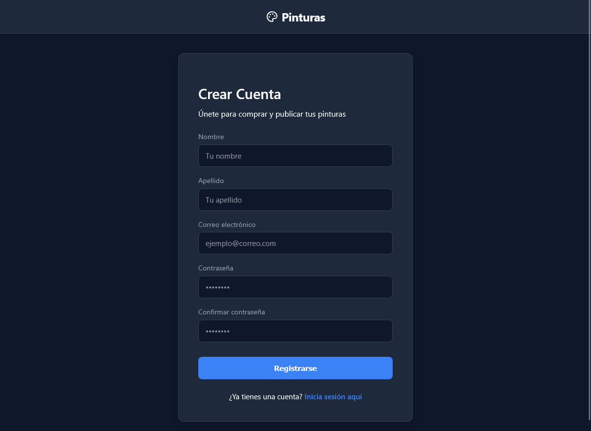
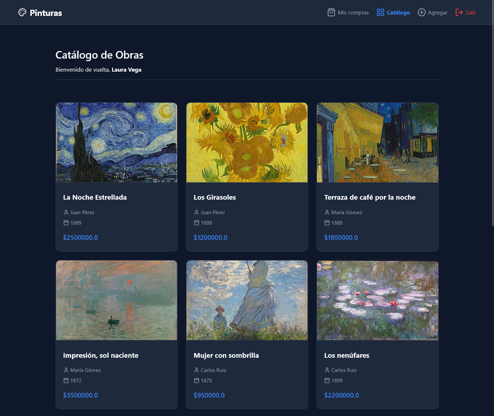
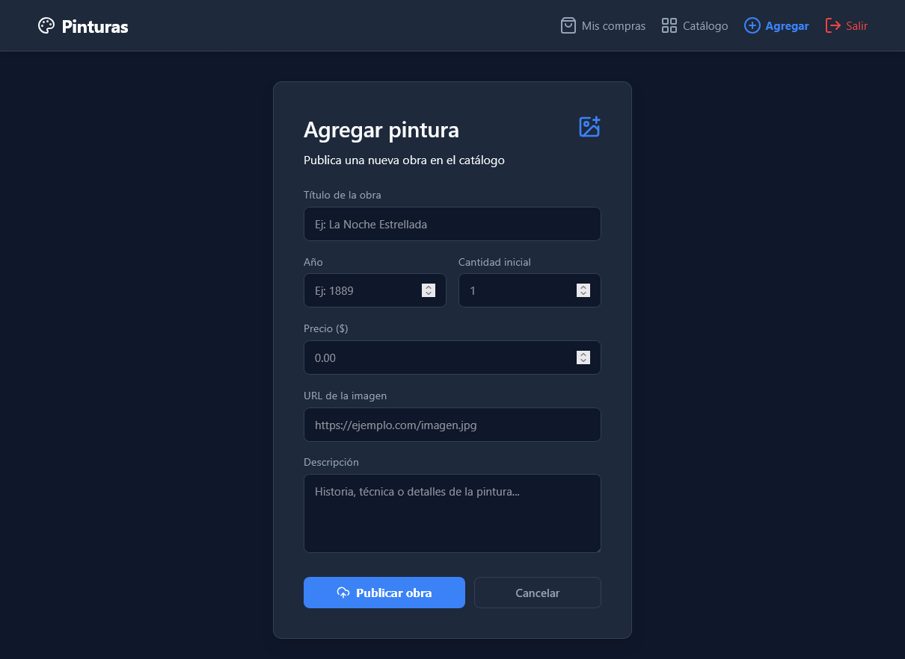
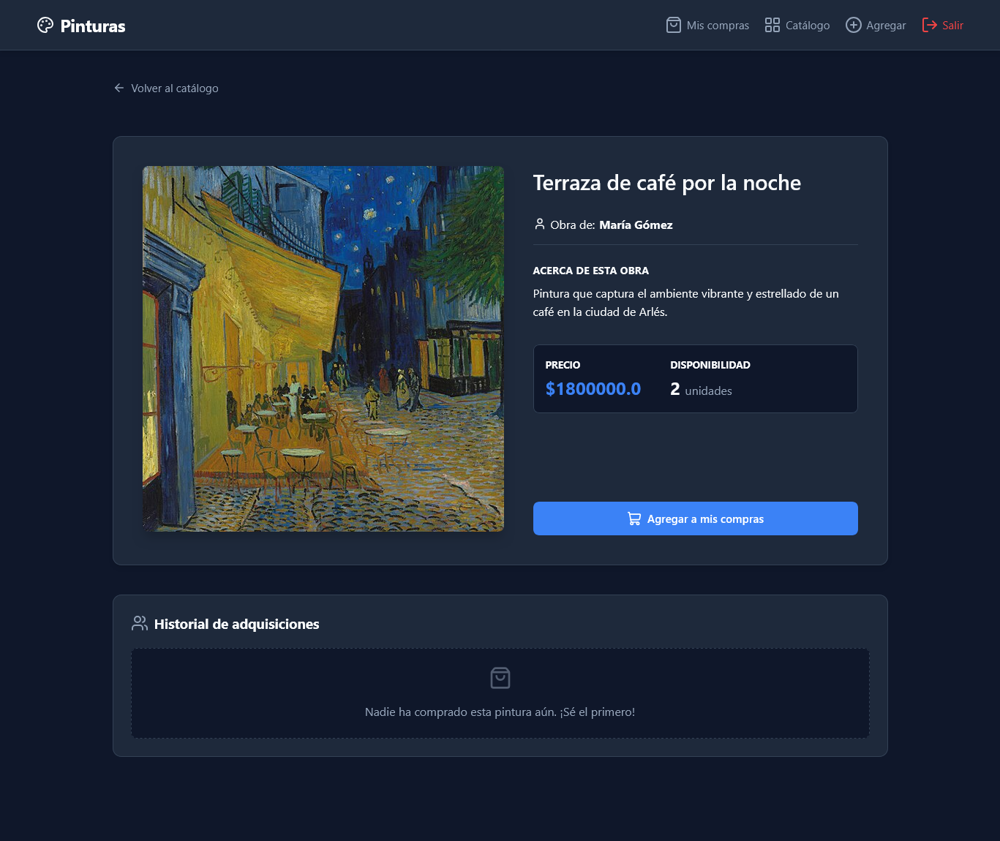
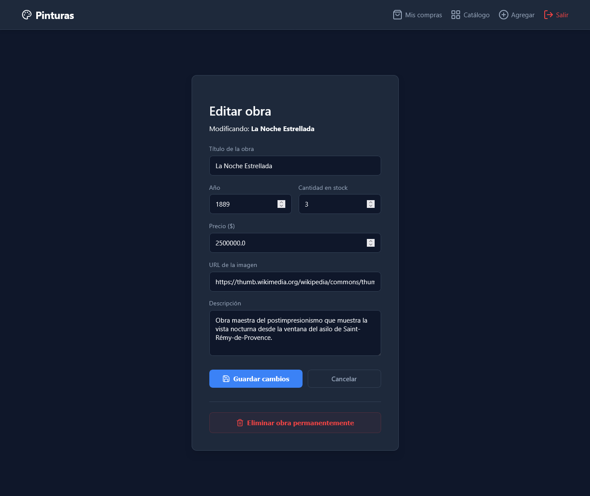

🌍 Read in [English](README.md)

# 🎨 Sistema de Gestión de Pinturas

> Proyecto desarrollado como examen de certificación para el Bootcamp Java Full Stack impartido por Skillnest y auspiciado por el Banco de Chile.

Este proyecto es una aplicación web Full Stack desarrollada en Java con **Spring Boot** utilizando el patrón de arquitectura **MVC** (Modelo-Vista-Controlador). La plataforma permite la gestión de un catálogo de arte (pinturas), donde los usuarios pueden registrarse, publicar sus propias obras, explorar la galería completa y adquirir (comprar) pinturas disponibles, gestionando automáticamente el inventario y el historial de compras.

## 🚀 Características Principales

* **Autenticación y Seguridad:** Sistema de registro e inicio de sesión seguro, con encriptación de contraseñas mediante BCrypt y control de acceso basado en sesiones de usuario.
* **UI/UX Moderno y Diseño Responsivo:** Interfaz en Modo Oscuro (Dark Mode) totalmente personalizada construida con variables CSS. Cuenta con diseños responsivos que utilizan CSS Grid para el catálogo y Flexbox para las tarjetas de autenticación centradas.
* **Arquitectura Frontend Modular:** Estructura JSP que cumple con el principio DRY utilizando fragmentos de diseño (barras de navegación y encabezados) y estados activos dinámicos basados en parámetros de URL.
* **Gestión Avanzada de Galería:** Los usuarios autenticados pueden publicar, editar y eliminar sus obras de arte. Las acciones destructivas (como eliminar una pintura) están protegidas por ventanas de confirmación nativas de JavaScript para evitar la pérdida accidental de datos.
* **Sistema de Adquisición y Manejo de Casos Extremos:** Lógica transaccional para comprar pinturas. El sistema actualiza dinámicamente la interfaz para reflejar los cambios en el stock, deshabilitando los botones de compra para artículos agotados o impidiendo compras duplicadas por el mismo usuario.
* **Validación de Datos Robusta:** Estricta validación en el backend (Jakarta Validation) para la integridad de los datos (precios positivos, URLs válidas), junto con consultas personalizadas a la base de datos para evitar que se registren títulos de obras duplicados. Incluye "Estados Vacíos" (Empty States) diseñados para catálogos o historiales de usuarios sin contenido.

## 🛠️ Stack Tecnológico

* **Backend:** Java 17, Spring Boot (Web, MVC, Validation).
* **Persistencia de Datos:** Spring Data JPA (Hibernate), Conector MySQL.
* **Frontend:** JSP (JavaServer Pages), JSTL, HTML5, CSS3 (Tema Oscuro Personalizado).
* **Recursos:** Lucide Icons (Iconografía vectorial).
* **Seguridad:** jBcrypt (Hashing de contraseñas).
* **Gestor de Dependencias:** Maven.

## 📋 Requisitos

Para ejecutar este proyecto en tu entorno local, asegúrate de tener instalado lo siguiente:

* **Java Development Kit (JDK)** versión 17 o superior.
* **Maven** (para compilar y gestionar dependencias).
* **MySQL Server**.
* Un IDE (como Eclipse, IntelliJ IDEA o VS Code).

## ⚙️ Configuración de la Base de Datos

El sistema utiliza MySQL para almacenar información sobre los usuarios, las pinturas y sus relaciones.

1. Abre tu gestor de base de datos MySQL.
2. Crea una nueva base de datos para el proyecto (por ejemplo, `pinturas_db`):
   ```sql
   CREATE DATABASE pinturas_db;
   ```
3. Verifica que en tu archivo `src/main/resources/application.properties`, las credenciales coincidan con tu entorno local:
   
   ```properties
   spring.datasource.url=jdbc:mysql://localhost:3306/pinturas_db
   spring.datasource.username=root
   spring.datasource.password=TU_CONTRASEÑA
   spring.jpa.hibernate.ddl-auto=update
   ```
   *(Nota: `ddl-auto=update` creará automáticamente las tablas `usuarios`, `pinturas` y la tabla intermedia `compras` al iniciar).*

## 🏃‍♂️ Pasos para ejecutarlo

1. Clona el repositorio:
   ```bash
   git clone https://github.com/CristinaTiznado/paintings-management-system.git
   ```
2. Accede al directorio del proyecto:
   ```bash
   cd Pinturas
   ```
3. Inicia la aplicación:
   ```bash
   mvn spring-boot:run
   ```
4. Abre tu navegador y ve a: **`http://localhost:8080`**

## 💡 Uso de la Aplicación

1. **Registro/Login:** Crea una cuenta nueva o inicia sesión para acceder a la galería mediante el portal de autenticación centrado.
   
   *Vista de login*
   

   *Vista de registro*
   
   
2. **Explorar:** En la vista principal (`/pinturas`), verás todas las obras publicadas por la comunidad presentadas en una cuadrícula responsiva.

   *Catálogo vacío*
   

   *Vista del catálogo*
   

3. **Publicar Obra:** Ve a "Agregar" para registrar una nueva pintura. El sistema validará que el título sea único antes de publicar.

   *Agregar pintura*
   

4. **Comprar:** Haz clic en cualquier pintura del catálogo para ver sus detalles. Si hay inventario disponible y aún no la has comprado, puedes hacer clic en "Agregar a mis compras".
   
   *Detalles de la pintura*
   

   *Estado ya adquirida*
   

   *Estado sin stock*
   

5. **Mis Compras:** Revisa el historial de las pinturas que has adquirido en tu sección dedicada de la galería.
   
   *Vista para usuarios nuevos sin compras*
   

   *Vista para usuarios con compras*
   

6. **Gestionar:** Si eres el autor original de una pintura, verás un botón de edición destacado que te permite actualizar su información o eliminarla permanentemente.

   *Botón de edición en el dashboard*
   

   *Formulario de edición de obra*
   

   *Confirmación de eliminación*
   
