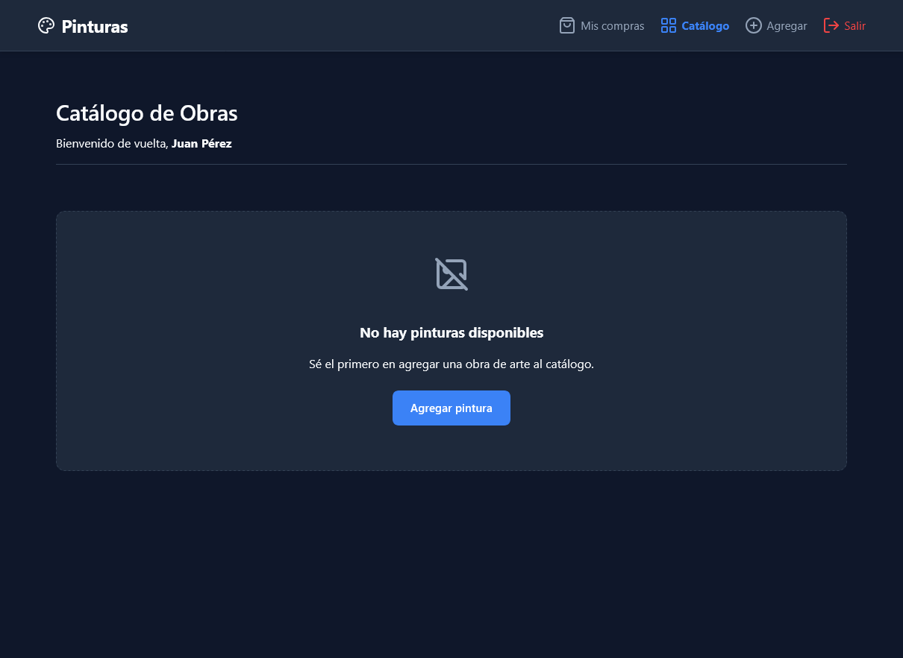
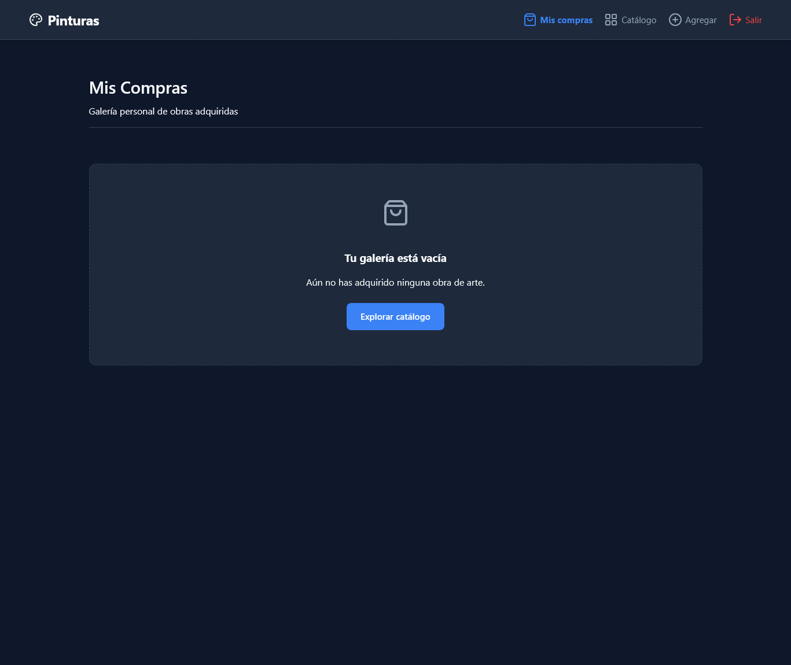
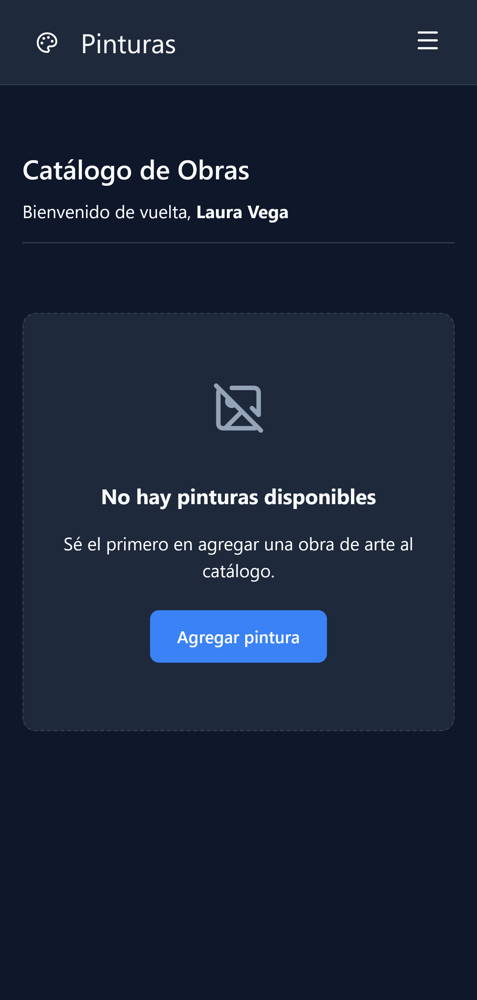
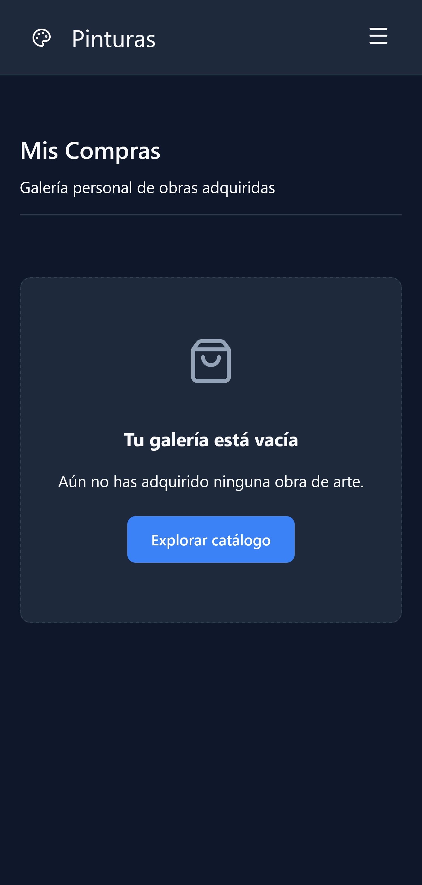

🌍 *Leer en [Inglés](README.md)*

# 🎨 Sistema de Gestión de Pinturas

**Sistema de Gestión de Pinturas** es una aplicación web Full Stack en Java diseñada para administrar un catálogo de arte. Permite a los usuarios registrarse, publicar sus propias obras, explorar la galería completa y adquirir las pinturas disponibles, gestionando automáticamente el inventario y el historial de compras. Desarrollado originalmente como examen de certificación para el Bootcamp Full Stack Java impartido por **Skillnest** y patrocinado por **Banco de Chile**, el proyecto cuenta con una interfaz en Modo Oscuro (Dark Mode) completamente personalizada, lógica transaccional robusta y estrictas validaciones en el backend.

## ✨ Características Principales

* 🔐 **Autenticación y Seguridad:** Sistema seguro de registro e inicio de sesión, con encriptación de contraseñas mediante BCrypt y control de acceso basado en sesiones de usuario.

* 📱 **Diseño UI/UX Moderno y Responsivo:** Interfaz en Modo Oscuro construida desde cero con variables CSS. Presenta diseños responsivos que utilizan CSS Grid para el catálogo y Flexbox para las tarjetas de autenticación centradas.

* 🏗️ **Arquitectura Frontend Modular:** Estructura de vistas JSP aplicando el principio DRY (Don't Repeat Yourself) mediante el uso de fragmentos (navbars y headers) y estados activos dinámicos basados en los parámetros de la URL.

* 📝 **Gestión Avanzada de Galería:** Los usuarios autenticados pueden publicar, editar y eliminar sus obras de arte. Las acciones destructivas (como eliminar) están protegidas por alertas de confirmación nativas en JS.

* 🛒 **Sistema de Adquisición y Casos Extremos:** Lógica transaccional para la compra de pinturas. El sistema actualiza dinámicamente la UI para reflejar cambios en el stock, deshabilitando botones de compra para artículos agotados o previniendo compras duplicadas.

* ✅ **Validación Robusta de Datos:** Estricta validación en el backend (Jakarta Validation) para asegurar la integridad de los datos, combinada con consultas personalizadas a la base de datos para evitar que se registren títulos de obras duplicados.

## 📸 Demos del Proyecto

¡Mira el sistema en acción! A continuación, se muestran los flujos de navegación completos de la aplicación, incluyendo la autenticación, exploración del catálogo, publicación de obras y el sistema de compras.

*Experiencia de Escritorio*<br>

https://github.com/user-attachments/assets/de96845b-3a7b-4263-8f64-b22d4dfbdeb8

<br>

*Experiencia Móvil*<br>

https://github.com/user-attachments/assets/4a665cec-e58e-4d2e-b436-6df00ebb3f14

### Estados Vacíos y Casos Especiales

Ilustraciones a medida y manejo dinámico de la interfaz para catálogos vacíos, artículos sin stock y obras previamente adquiridas, garantizando una excelente experiencia de usuario.

*Dashboard Vacío*<br>


*Historial de Compras Vacío*<br>


*Dashboard Vacío Versión Mobil*<br>


*Historial de Compras Vacío Versión Mobil*<br>


## 🛠️ Stack Tecnológico

* **Backend:** Java 17, Spring Boot, Spring MVC, Spring Data JPA, Hibernate, Bean Validation.

* **Frontend:** JSP, JSTL, CSS3 (Custom Dark Theme, Flexbox, Grid), JavaScript.

* **Seguridad:** jBcrypt (Hashing de contraseñas).

* **Base de Datos:** MySQL.

* **Iconos:** [Lucide Icons](https://lucide.dev/).

## ⚙️ Configuración de la Base de Datos

1. Abre tu gestor de base de datos MySQL.

2. Crea la base de datos ejecutando:

   ```
   CREATE DATABASE pinturas_db;
   
   ```

3. Verifica que el archivo `src/main/resources/application.properties` tenga tus credenciales locales:

   ```
   spring.datasource.url=jdbc:mysql://localhost:3306/pinturas_db
   spring.datasource.username=root
   spring.datasource.password=TU_CONTRASEÑA
   spring.jpa.hibernate.ddl-auto=update
   
   ```

   *(Hibernate creará automáticamente las tablas `usuarios`, `pinturas` y `compras` al iniciar).*

## 🏃‍♂️ Pasos para ejecutar

1. Clona este repositorio:

   ```
   git clone https://github.com/CristinaTiznado/paintings-management-system.git
   
   ```

2. Navega al directorio del proyecto:

   ```
   cd Pinturas
   
   ```

3. Inicia la aplicación:

   ```
   mvn spring-boot:run
   
   ```

4. Abre tu navegador en: **`http://localhost:8080`**

*Desarrollado por **Cristina Tiznado** para muestra de portafolio.*
