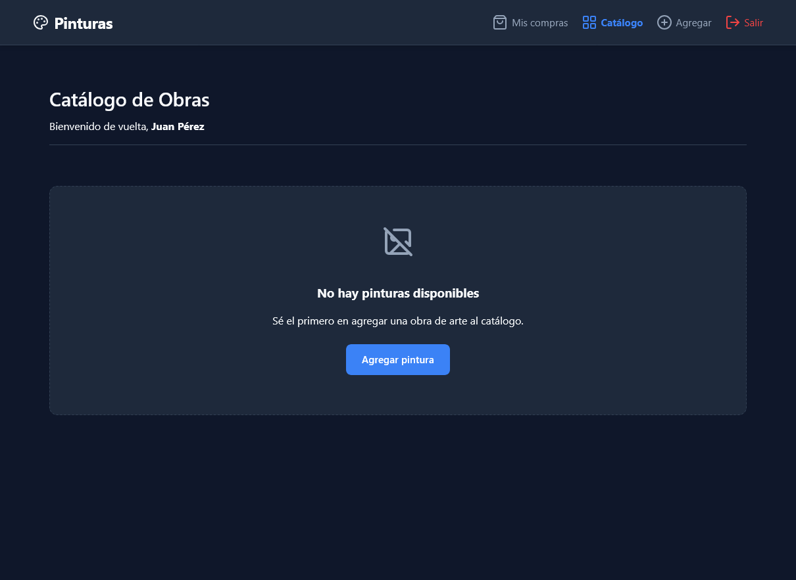
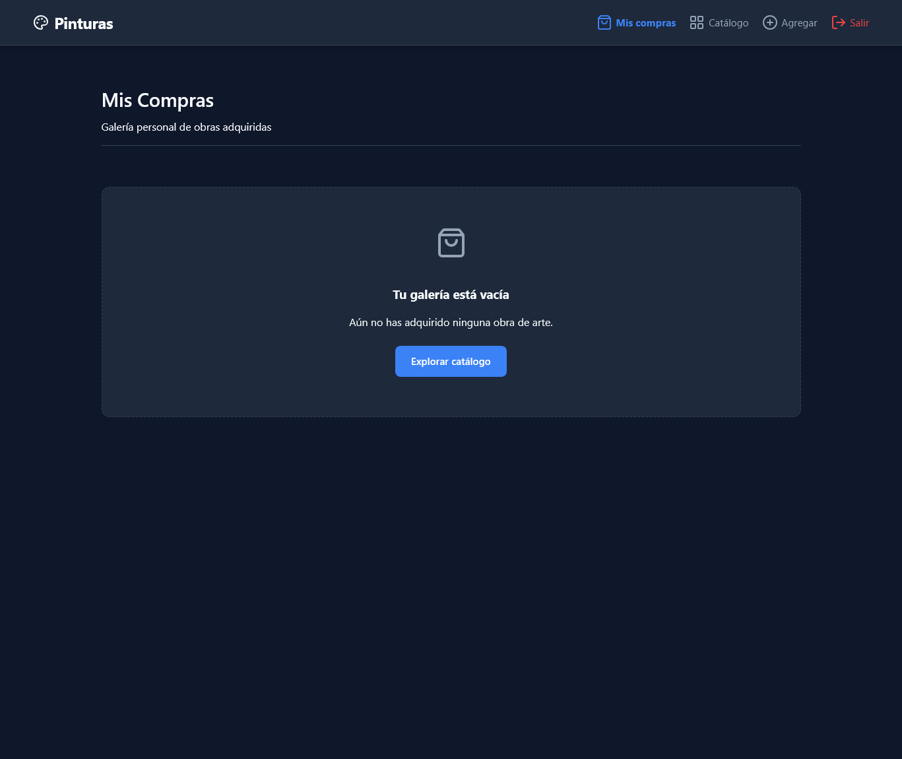
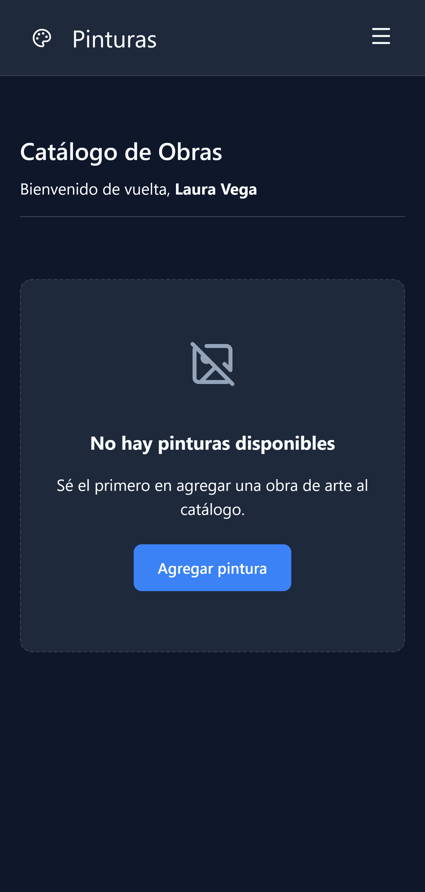
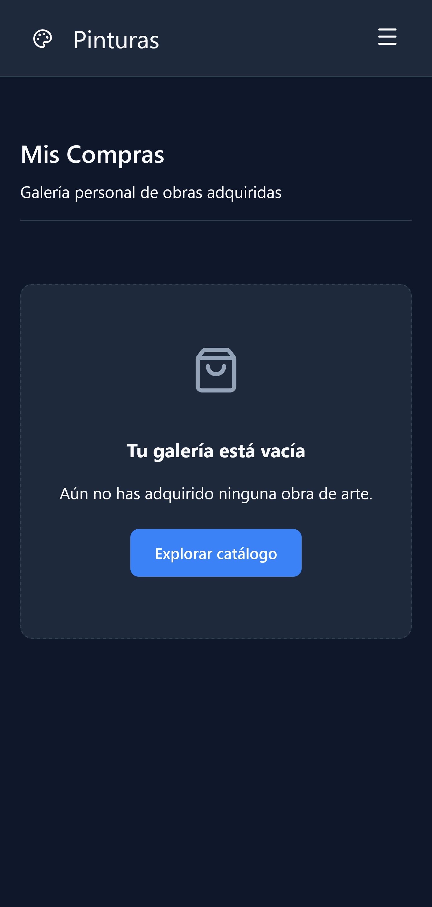

🌍 *Read in [Español](README-es.md)*

# 🎨 Paintings Management System


**Paintings Management System** is a Full Stack Java web application designed to manage an art catalog. It allows users to register, publish their own artworks, explore the complete gallery, and acquire available paintings, automatically managing inventory and purchase history. Originally developed as a certification exam for the Full Stack Java Bootcamp by **Skillnest** and **Banco de Chile**, the project features a fully custom Dark Mode interface, robust transactional logic, and strict backend validations.

## ✨ Key Features

* 🔐 **Authentication and Security:** Secure registration and login system, with password encryption using BCrypt and access control based on user sessions.
* 📱 **Modern UI & Responsive Design:** Fully custom Dark Mode interface built with CSS variables. Features responsive layouts utilizing CSS Grid for the catalog and Flexbox for centered authentication cards.
* 🏗️ **Modular Frontend Architecture:** DRY-compliant JSP structure using layout fragments (navbars and headers) and dynamic active states based on URL parameters.
* 📝 **Advanced Gallery Management:** Authenticated users can publish, edit, and delete their artworks. Destructive actions are protected by native JS confirmation prompts.
* 🛒 **Acquisition System & Edge-Case Handling:** Transactional logic for buying paintings. The system dynamically updates the UI to reflect stock changes, disabling purchase buttons for out-of-stock items or preventing duplicate purchases.
* ✅ **Robust Data Validation:** Strict backend validation (Jakarta Validation) for data integrity, coupled with custom database queries to prevent duplicate artwork titles.

## 📸 Project Demos

See the Paintings Management System in action! Below are the full navigation flows for the application, including user authentication, gallery exploration, artwork publishing, and the acquisition system.

*Desktop Experience*<br>

https://github.com/user-attachments/assets/25e5d259-58d4-467d-a301-882d6407d880

<br>

*Mobile Experience*<br>

https://github.com/user-attachments/assets/f086cd48-a5c1-4240-a6b1-ca5137bf86c4

### Empty States & Edge Cases
Custom illustrations and dynamic UI handling for empty catalogs, out-of-stock items, and previously acquired paintings, ensuring a polished user experience.

*Empty Dashboard*<br>


*Empty Purchases History*<br>


*Empty Dashboard Mobile Version*<br>


*Empty Purchases History Mobile Version*<br>


## 🛠️ Tech Stack

* **Backend:** Java 17, Spring Boot, Spring MVC, Spring Data JPA, Hibernate, Bean Validation.
* **Frontend:** JSP, JSTL, Custom CSS3 (Dark Theme, Flexbox, Grid), JavaScript.
* **Security:** jBcrypt (Password hashing).
* **Database:** MySQL.
* **Icons:** [Lucide Icons](https://lucide.dev/).

## ⚙️ Database Configuration

1. Open your MySQL manager.
2. Create the database by running:
   
   ```sql
   CREATE DATABASE pinturas_db;
   ```
3. Verify that the `src/main/resources/application.properties` file has your local credentials:
   
   ```properties
   spring.datasource.url=jdbc:mysql://localhost:3306/pinturas_db
   spring.datasource.username=root
   spring.datasource.password=YOUR_PASSWORD
   spring.jpa.hibernate.ddl-auto=update
   ```
   *(Hibernate will create the `usuarios`, `pinturas`, and `compras` tables automatically).*

## 🏃‍♂️ Steps to run

1. Clone this repository:
   
   ```bash
   git clone https://github.com/CristinaTiznado/paintings-management-system.git
   ```
2. Navigate to the project directory:
   
   ```bash
   cd Pinturas
   ```
3. Start the application:
   
   ```bash
   mvn spring-boot:run
   ```
4. Open in your browser: **`http://localhost:8080`**

---
*Developed by **Cristina Tiznado** for portfolio display.*
